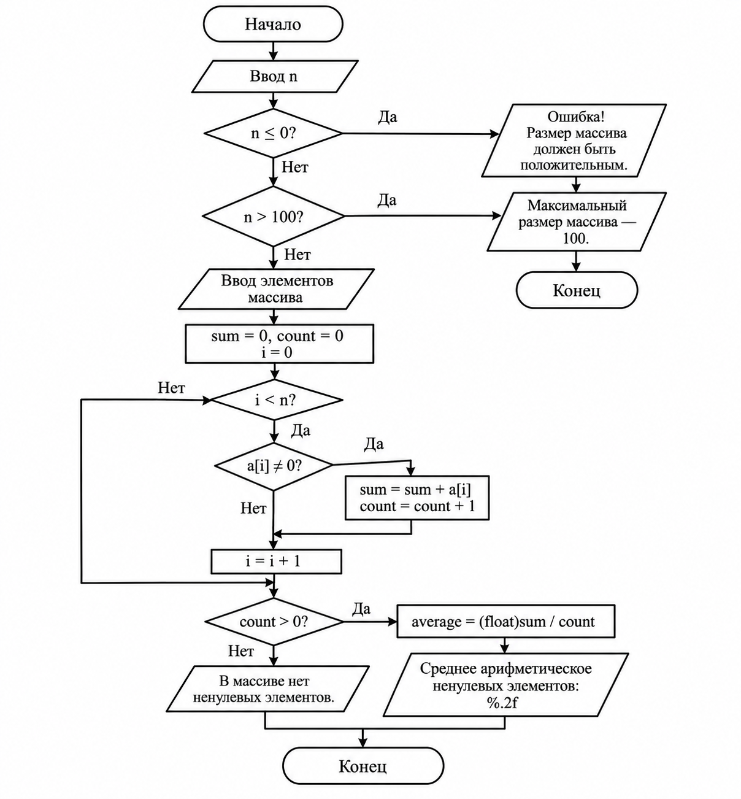

## ДОМАШНЕЕ ЗАДАНИЕ К РАБОТА 11
 
## Условие

Разработать программу на языке C для вычисления среднего арифметического ненулевых элементов массива. Пользователь вводит количество элементов и их значения. Программа должна определить среднее арифметическое, не учитывая нулевые элементы массива.

## 1. Алгоритм работы

1. Начало программы.
2. Объявление переменных для хранения размера массива, суммы элементов и количества ненулевых элементов.
3. Ввод количества элементов массива.
4. Проверка правильности введённого размера:
   - Если размер меньше или равен нулю, вывести сообщение об ошибке.
   - Если размер больше 100, вывести сообщение о превышении допустимого размера.
5. Объявление массива из 100 элементов.
6. Ввод элементов массива.
7. Проверка каждого элемента:
   - Если элемент не равен нулю, добавить его к общей сумме.
   - Увеличить счётчик ненулевых элементов.
8. Проверка количества ненулевых элементов:
   - Если количество больше нуля, вычислить среднее арифметическое.
   - Если ненулевых элементов нет, вывести соответствующее сообщение.
9. Вывод результата на экран.
10. Конец программы.

## Блок-схема

[Открыть блок-схему](images/block_scheme.png)

## 2. Реализация программы

Программа реализована на языке C с использованием массивов, циклов и условных операторов. Для ввода данных используется функция `scanf_s()`, а для вычисления среднего арифметического — деление суммы ненулевых элементов на их количество.

## 3. Результат работы программы

Программа позволяет ввести массив размером от 1 до 100 элементов, вычислить сумму и количество ненулевых элементов, а затем найти их среднее арифметическое. Если все элементы массива равны нулю, программа выводит соответствующее сообщение.

## Информация о разработчике
Запорин Артём, бТИИ-262
